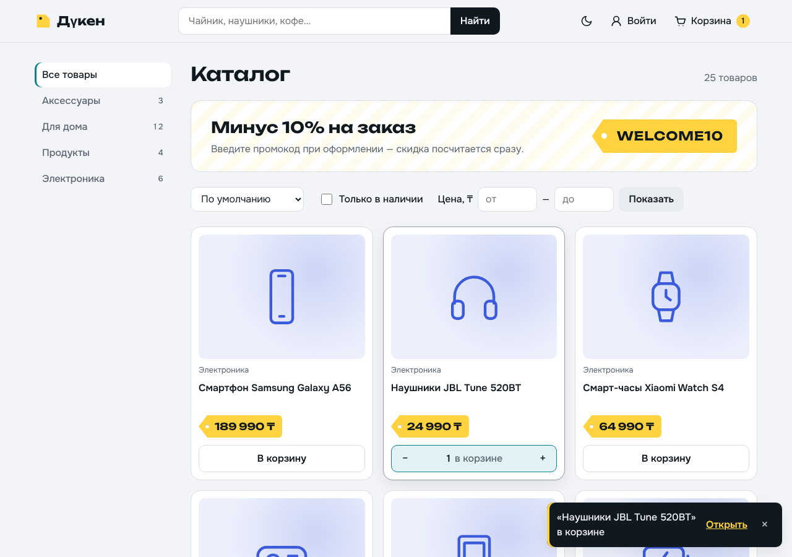
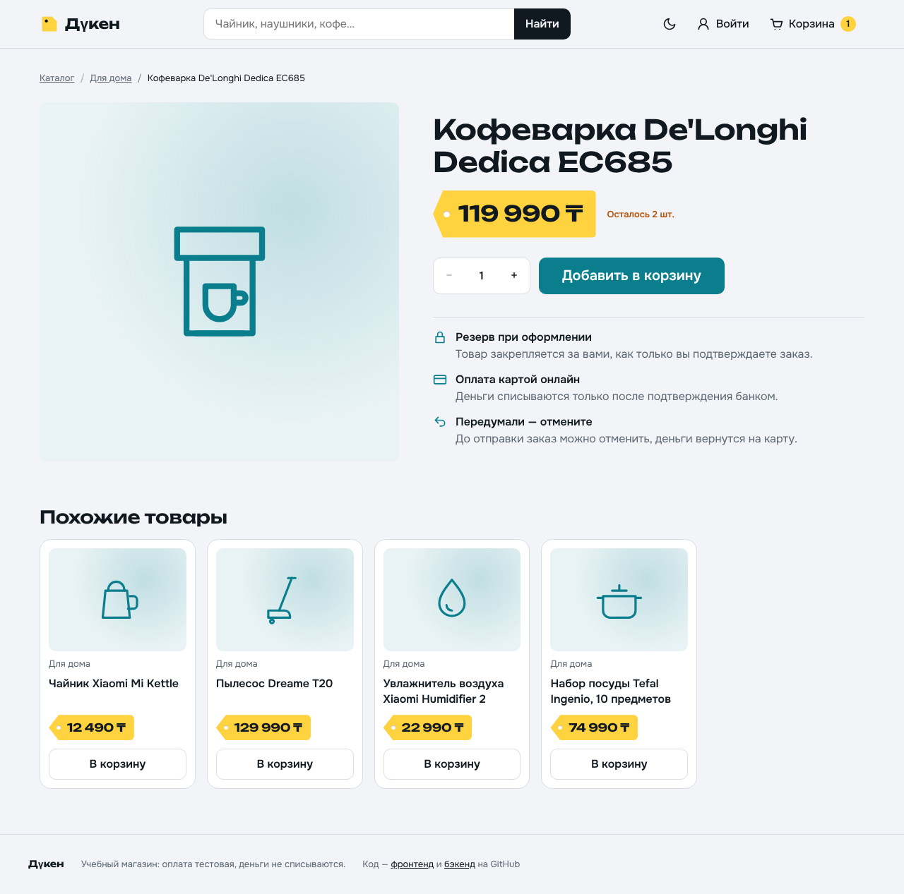
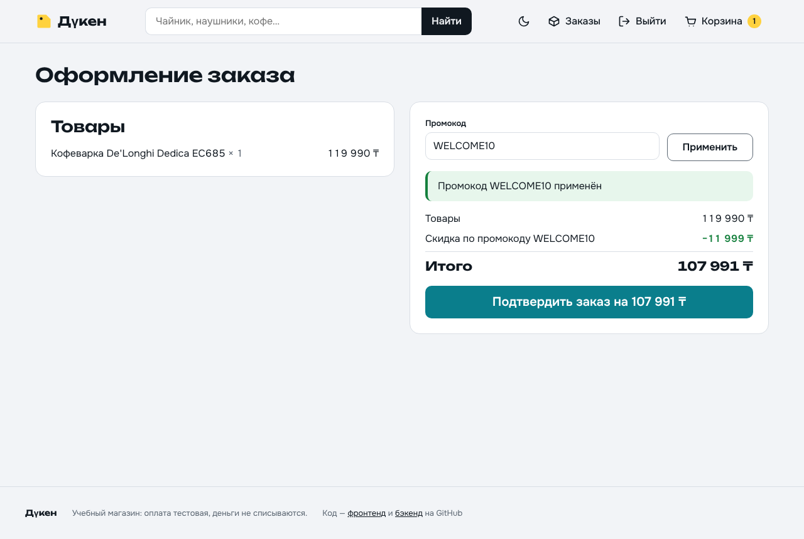
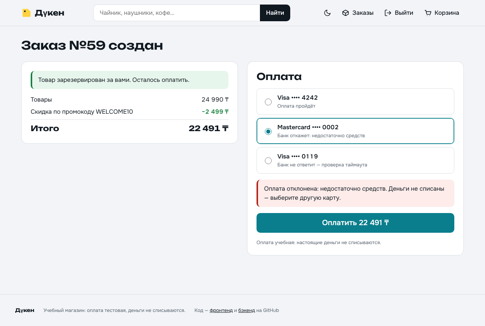
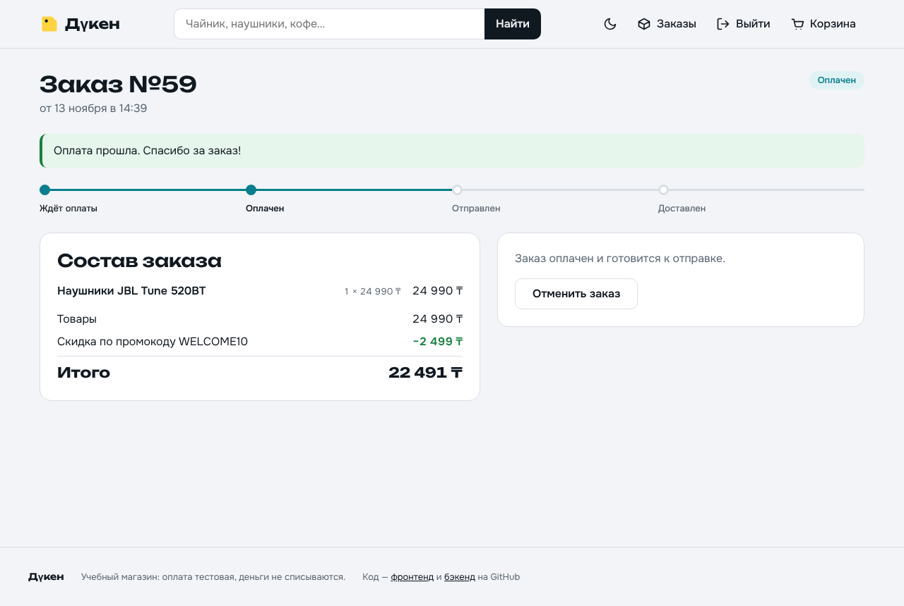

# Duken — storefront and admin panel for an online shop

[](https://github.com/A160LKN/shop-web/actions/workflows/ci.yml)

[Русский](README.md) · **English**

A React and TypeScript frontend for my [Shop API](https://github.com/A160LKN/shop-api) backend: catalogue, cart, checkout with a promo code, payment through a payment gateway, order history and an admin panel. Together with Shop API it is a complete fullstack application. _Duken_ means "shop" in Kazakh.

**[Open the shop →](https://shop-web-azure.vercel.app)** Admin sign-in: `admin@shop.kz` / `admin12345`, promo code `WELCOME10`, payments are simulated. The API runs on a free tier and sleeps when idle, so the first load can take up to a minute. The interface is in Russian.



## Features

**Customer**

- catalogue with search, categories, sorting (newest, cheapest, most expensive, by name), an "in stock only" filter and a price range — all state lives in the URL, so a link can be shared;
- product page with breadcrumbs and similar products from the same category; quantity can be changed right on the catalogue card;
- the cart survives a reload and is **reconciled with the server**: if a price changed or an item sold out while the customer was thinking, they see it before checkout, not after an error;
- two-step checkout, like real shops: the order reserves the stock, payment is separate and can be retried;
- **the server calculates the total** (`POST /orders/quote`): the promo discount is visible before confirming, and the button states the exact amount — "Confirm order for 107 991 ₸"; the promo code is not consumed by the quote;
- payment handles every gateway response: success, card declined, gateway timeout;
- my orders with a status timeline and cancellation with a refund;
- notifications for actions (added to cart, promo copied, order cancelled) with a link to the result.

**Administrator**

- dashboard: revenue, paid orders, average order value, a 7-day revenue chart, orders by status, best sellers and low stock (`GET /stats`);
- products: create, edit, take off sale; prices are entered in tenge and sent to the API in tiyn;
- orders: status filter and pagination in the URL, the dashboard links straight to a status; shipping and delivery;
- promo codes: create and list with state — active, expired, used up.

| Product and similar items                | Checkout: total from the server            |
| ---------------------------------------- | ------------------------------------------ |
|  |  |
| **Payment and a declined card**          | **Order**                                  |
|  |        |

## Stack

**React 19, TypeScript** (strict), React Router, TanStack Query, React Hook Form + Zod, CSS Modules, Vite
**Tests:** Vitest, Testing Library, MSW, Playwright · **Quality:** ESLint (strict type-checked), Prettier · **CI:** GitHub Actions

## Design decisions worth knowing

- **API types are generated from the Shop API OpenAPI schema** (`openapi-typescript` + `openapi-fetch`). If the backend changes a field, the frontend stops compiling, and CI compares the types with the real running API and fails on any mismatch — the contract is checked on every change.
- **Server state lives in TanStack Query**: caching, retries only for network and server failures (a retry will not fix a 404), invalidation after mutations — after payment both the order and the stock levels refresh.
- **One error shape**: every API response becomes an `ApiError` with a code and a readable message, network failures included. An expired token signs the user out instead of leaving a half-signed-in interface.
- **Client-side safety**: the post-login redirect only goes to internal paths (`?next=//evil.example` will not work); the UI hides the admin panel, but the API still checks permissions.
- **Money is integer tiyn**, formatted with `Intl` and a non-breaking space before ₸.
- **Every screen has loading, error and empty states**; there is a skip link, visible focus, screen-reader labels and respect for `prefers-reduced-motion`.
- **The admin panel is a separate bundle** — customers never download its code.
- **Design**: custom, no UI kit. The signature element is a yellow price tag with a hole for the string, like on a market stall; products have no photos, so an icon is picked from the meaning of the name. Light and dark themes.

## Tests — 120 component and 29 E2E

| Level                    | Tools                                                              | What they check                                                                                                                                                                                                                                                                          |
| ------------------------ | ------------------------------------------------------------------ | ---------------------------------------------------------------------------------------------------------------------------------------------------------------------------------------------------------------------------------------------------------------------------------------- |
| Unit and component — 120 | Vitest, Testing Library, **MSW** (API mocked at the network level) | money and plural forms, the cart and its limits, pages in loading, error and empty states, cart reconciliation, every payment gateway response, protected pages, safe post-login redirect, catalogue filters in the URL, totals, admin dashboard                                         |
| E2E — 29                 | Playwright against the **real Shop API** in Docker, **axe**        | accessibility (WCAG 2.1 AA) in light and dark themes, the customer journey from catalogue to payment, a declined card and retry, gateway timeout, cancellation with refund, admin adds a product and delivers an order, sorting and filters, admin dashboard, permissions, mobile layout |

The tests found and closed two frontend defects:

- regular expressions with `\b` do not work with Cyrillic, so "Green tea" and "Mountain honey" had the wrong icons in the catalogue (unit test);
- the API client captured `fetch` when the module loaded, so test mocks did not intercept it and requests went to the real server.

## Running locally

Requires Node.js 20+ and a running [Shop API](https://github.com/A160LKN/shop-api) (`docker compose up` in its folder).

```bash
npm install
npm run dev            # http://localhost:5173

npm test               # unit and component tests
npm run test:coverage  # with coverage
npm run test:e2e       # E2E: builds the frontend and runs against the API at localhost:8000
npm run lint && npm run typecheck
```

The API address is set with `VITE_API_URL` (see `.env.example`). After an API change: update `src/api/openapi.json` and run `npm run api:types`.

## CI

1. **Quality** — TypeScript, ESLint, Prettier, tests with a coverage threshold, build.
2. **E2E** — starts Shop API, PostgreSQL and the payment gateway from the backend repository in Docker, checks the API contract and runs Playwright.

## Security and accessibility

- **Vercel headers:** a strict CSP (own scripts only, requests only to our API), HSTS, no framing. Policy: [SECURITY.md](SECURITY.md).
- **Every CI run:** npm audit, CodeQL and axe accessibility checks of the storefront, cart, orders and admin — in light and dark themes.
- **What the checks found:** low-contrast status badge and active link, button names that did not match their visible text, a prohibited ARIA attribute, and a critical `tinypool` advisory (via Vitest 3). All fixed.
