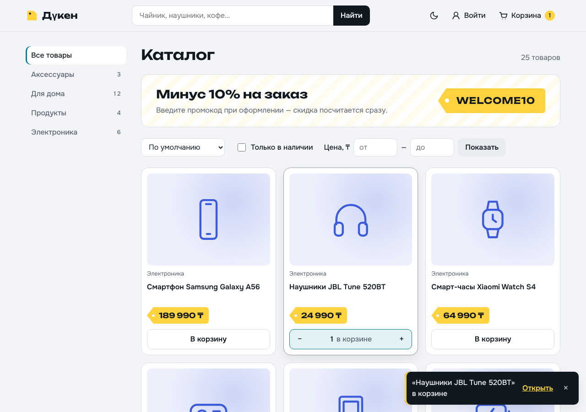
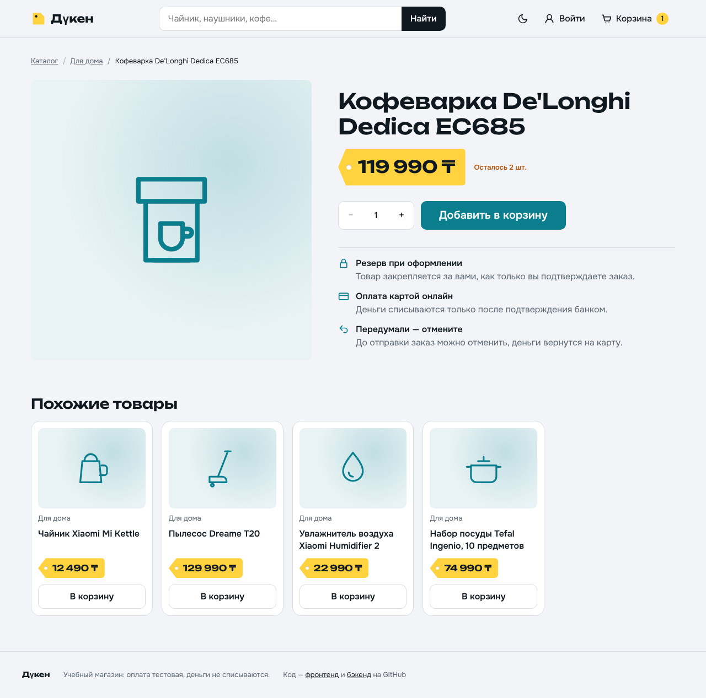
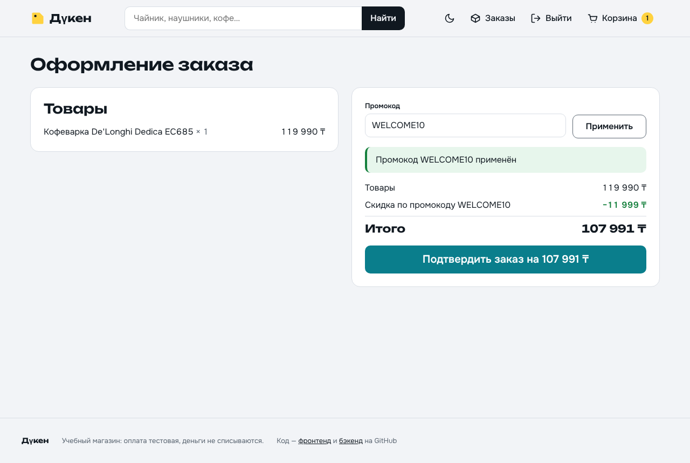
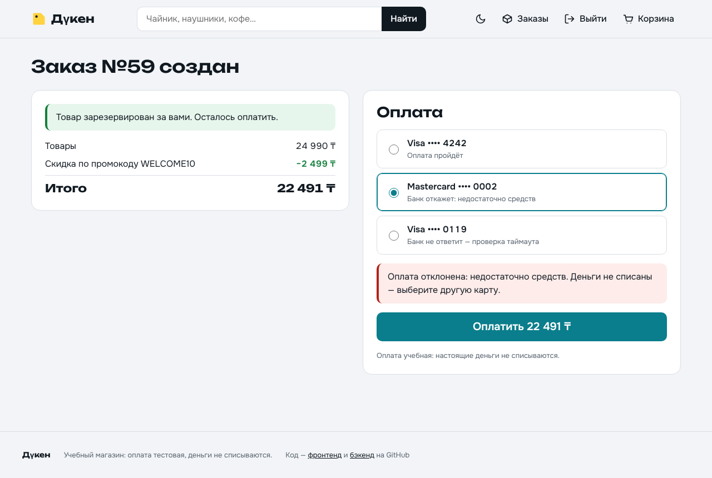
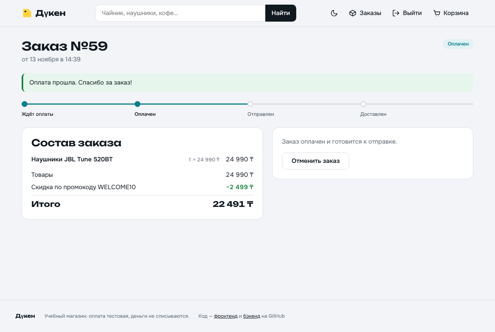
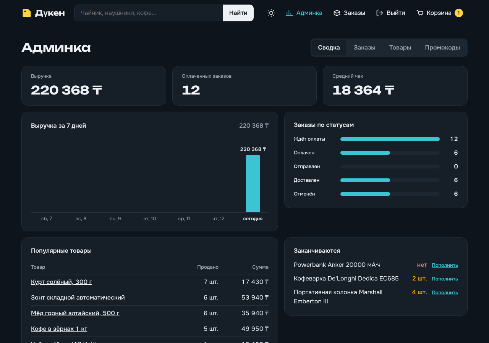
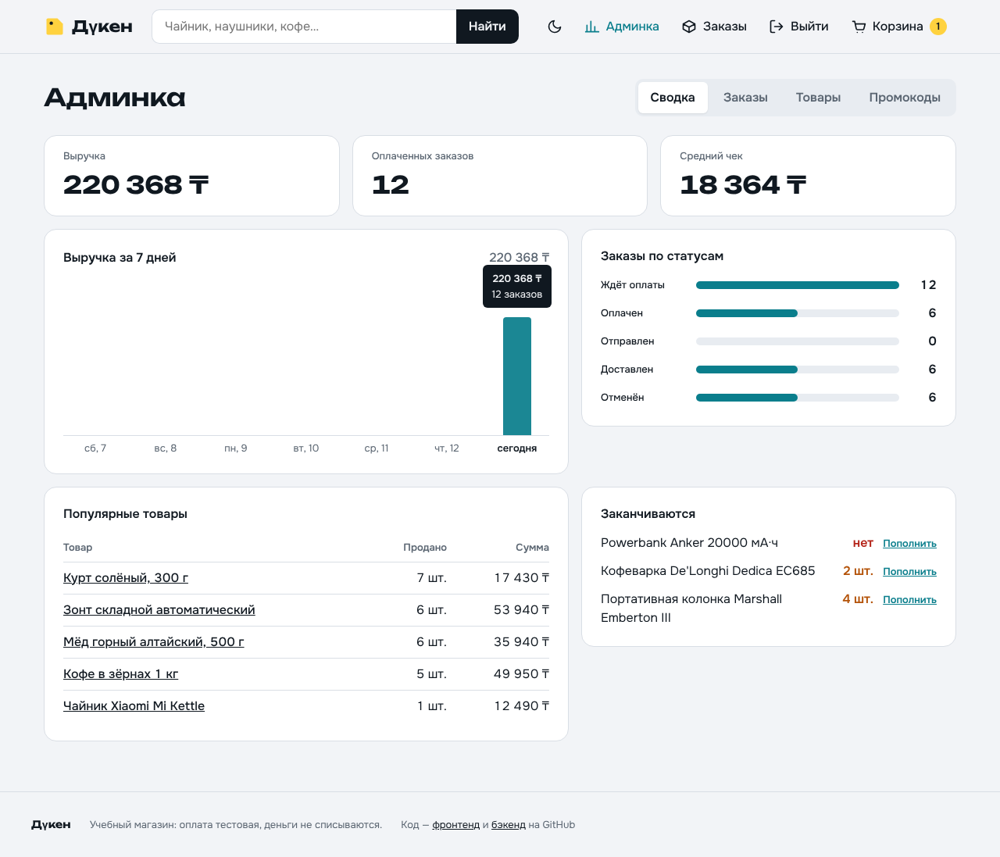
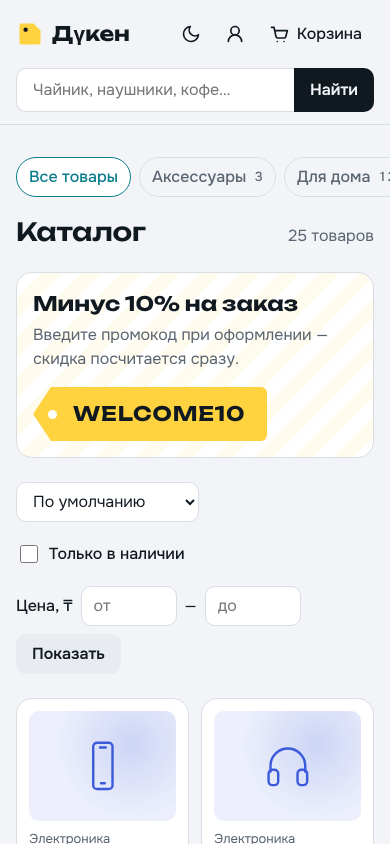

# Дүкен — витрина и админка интернет-магазина

[](https://github.com/A160LKN/shop-web/actions/workflows/ci.yml)

Фронтенд на React и TypeScript для моего бэкенда [Shop API](https://github.com/A160LKN/shop-api): каталог, корзина, оформление заказа с промокодом, оплата через платёжный шлюз, история заказов и админка. Вместе с Shop API — полноценное fullstack-приложение.



## Что умеет

**Покупатель**

- каталог с поиском, категориями, сортировкой (новые, дешевле, дороже, по названию), фильтром «только в наличии» и ценой «от–до» — всё состояние в адресе страницы, ссылкой можно поделиться;
- карточка товара с хлебными крошками и похожими товарами из той же категории; количество меняется прямо в карточке каталога;
- корзина сохраняется после перезагрузки и **сверяется с сервером**: если цена изменилась или товар закончился, пока покупатель думал, — он видит это до оформления, а не после ошибки;
- оформление в два шага, как в настоящих магазинах: заказ резервирует товар, оплата — отдельно и её можно повторить;
- **итог считает сервер** (`POST /orders/quote`): скидка по промокоду видна до подтверждения, а кнопка называет точную сумму — «Подтвердить заказ на 107 991 ₸»; промокод при этом не расходуется;
- оплата обрабатывает все ответы шлюза: успех, отказ банка, шлюз не отвечает;
- мои заказы со шкалой статуса и отменой с возвратом денег;
- уведомления о действиях (добавлено в корзину, промокод скопирован, заказ отменён) с кнопкой перехода.

**Администратор**

- сводка: выручка, число оплаченных заказов, средний чек, график выручки за 7 дней, заказы по статусам, популярные товары и что заканчивается на складе (`GET /stats`);
- товары: добавление, изменение, снятие с продажи; цены вводятся в тенге, в API уходят в тиынах;
- заказы: фильтр по статусу и страницы — в адресе, из сводки можно перейти сразу к нужному статусу; отправка и доставка;
- промокоды: создание и список с состоянием — действует, истёк, исчерпан.

| Товар и похожие                         | Оформление: итог от сервера                  |
| --------------------------------------- | -------------------------------------------- |
|   |  |
| **Оплата и отказ банка**                | **Заказ**                                    |
|  |          |

| Тёмная тема                               | Админка                                         | Телефон                                 |
| ----------------------------------------- | ----------------------------------------------- | --------------------------------------- |
|  |  |  |

## Стек

**React 19, TypeScript** (strict), React Router, TanStack Query, React Hook Form + Zod, CSS Modules, Vite
**Тесты:** Vitest, Testing Library, MSW, Playwright · **Качество:** ESLint (strict type-checked), Prettier · **CI:** GitHub Actions

## Решения, о которых стоит знать

- **Типы API генерируются из OpenAPI-схемы Shop API** (`openapi-typescript` + `openapi-fetch`). Если бэкенд поменяет поле, фронтенд не соберётся, а CI сравнит типы с настоящим работающим API и упадёт при расхождении — контракт проверяется на каждом изменении.
- **Серверное состояние — в TanStack Query**: кеш, повторы только для сбоев сети и сервера (404 повтором не исправить), инвалидация после изменений — после оплаты обновляются и заказ, и остатки товаров.
- **Ошибки в одном виде**: любой ответ API превращается в `ApiError` с кодом и понятным текстом; сетевой сбой — тоже. Истёкший токен — автоматический выход, а не «полувошедший» интерфейс.
- **Безопасность на стороне клиента**: редирект после входа только на внутренние адреса (`?next=//evil.example` не сработает); интерфейс прячет админку, но права всё равно проверяет API.
- **Деньги — целые тиыны**, форматирование через `Intl` с неразрывным пробелом перед ₸.
- **Каждый экран продуман для загрузки, ошибки и пустого состояния**; есть пропуск к содержимому, видимый фокус, подписи для экранных дикторов, уважение к `prefers-reduced-motion`.
- **Админка загружается отдельным файлом** — покупатель её код не скачивает.
- **Дизайн**: свой, без UI-кита. Главный элемент — жёлтый ценник с дыркой для верёвочки, как на прилавке; у товаров нет фото, поэтому иконка подбирается по смыслу названия. Светлая и тёмная темы.

## Тесты — 120 компонентных и 25 E2E

| Уровень                   | Чем                                                       | Что проверяет                                                                                                                                                                                                                                               |
| ------------------------- | --------------------------------------------------------- | ----------------------------------------------------------------------------------------------------------------------------------------------------------------------------------------------------------------------------------------------------------- |
| Юнит и компонентные — 120 | Vitest, Testing Library, **MSW** (мок API на уровне сети) | деньги и склонения, корзина и её лимиты, страницы в состояниях загрузки, ошибки и пустоты, сверка корзины с сервером, все ответы платёжного шлюза, защита страниц, безопасный редирект после входа, фильтры каталога в адресе, расчёт итога, сводка админки |
| E2E — 25                  | Playwright против **настоящего Shop API** в Docker        | путь покупателя от каталога до оплаты, отказ банка и повтор, таймаут шлюза, отмена с возвратом, админ добавляет товар и доставляет заказ, сортировка и фильтры, сводка админки, права доступа, мобильная вёрстка                                            |

Тесты нашли и закрыли два дефекта фронтенда:

- регулярные выражения с `\b` не работают с кириллицей — у «Чай зелёный» и «Мёд горный» в каталоге были неправильные иконки (юнит-тест);
- клиент API запоминал `fetch` при загрузке модуля, и моки в тестах его не перехватывали — запросы уходили на настоящий сервер.

## Запуск

Нужны Node.js 20+ и запущенный [Shop API](https://github.com/A160LKN/shop-api) (`docker compose up` в его папке).

```bash
npm install
npm run dev            # http://localhost:5173

npm test               # юнит- и компонентные тесты
npm run test:coverage  # с покрытием
npm run test:e2e       # E2E: соберёт фронтенд и запустит против API на localhost:8000
npm run lint && npm run typecheck
```

Вход администратора: `admin@shop.kz` / `admin12345`. Промокод: `WELCOME10`. Тестовые карты выбираются на шаге оплаты.

Адрес API задаётся переменной `VITE_API_URL` (см. `.env.example`). После изменения API: обновить `src/api/openapi.json` и выполнить `npm run api:types`.

## Деплой

Фронтенд — на [Vercel](https://vercel.com): импортировать репозиторий, Vite определится сам, в переменных окружения указать `VITE_API_URL` — адрес Shop API. Переходы по страницам приложения обрабатывает [`vercel.json`](vercel.json).

API живёт на бесплатном хостинге и засыпает после простоя. Если загрузка затянулась дольше 4 секунд, сайт объясняет, что сервер просыпается, а не крутит пустой спиннер.

## Структура

```
src/
├── api/          — типизированный клиент, ошибки, запросы (TanStack Query), сгенерированные типы
├── auth/         — вход, токен, защита страниц
├── cart/         — корзина и сверка с сервером
├── components/   — ценник, иконки товаров, оплата, состояния загрузки и ошибок, поля форм
├── pages/        — страницы витрины и admin/ — админка
├── lib/          — деньги, склонения, категории, тема
├── styles/       — дизайн-токены и базовые стили
└── test/         — мок API (MSW) и помощники для тестов
e2e/              — Playwright
```

## CI

1. **Качество** — TypeScript, ESLint, Prettier, тесты с порогом покрытия, сборка.
2. **E2E** — поднимает Shop API, PostgreSQL и платёжный шлюз из репозитория бэкенда в Docker, сверяет контракт API и прогоняет Playwright.
